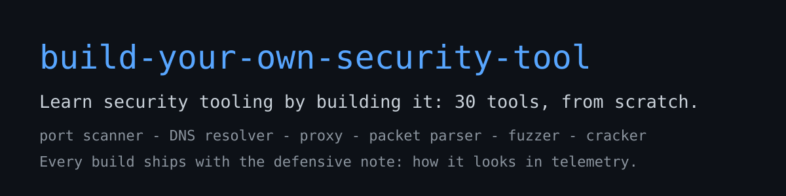

# build-your-own-security-tool

[](https://github.com/Epsilon0xCell/build-your-own-security-tool/releases) [](LICENSE) [](https://github.com/Epsilon0xCell/build-your-own-security-tool/stargazers)



**You do not learn security tooling by memorising other tools' flags. You learn it by building the scanner, the resolver, the proxy, and the cracker yourself, from the protocol up, until the flags of the professional tools stop being magic and start being obvious design choices.**

This is a curriculum of 30 from-scratch builds in Python: network plumbing first, then web tooling, credentials and crypto, fuzzing, and finally the detection side, because every offensive primitive in this map is paired with the defensive note that explains how it appears in telemetry. Each chapter follows the same anatomy: what you are building, the mechanism from first principles, the build in numbered steps, a complete working implementation, a smoke test that proves it against self-owned lab targets, exercises that extend it, and the defensive note.

## Start now: build Chapter 1 in five minutes

```sh
git clone https://github.com/Epsilon0xCell/build-your-own-security-tool.git
cd build-your-own-security-tool
python3 chapters/01-port-scanner/port_scanner.py 127.0.0.1 --ports 22,80,443,8080 --banner
```

No dependencies. Python 3.9 or newer. Then run the chapter's own proof:

```sh
python3 chapters/01-port-scanner/smoke_test.py
```

## The curriculum

Progress: **5 of 30 chapters complete.** The first five are full chapters with working, tested code. The rest are fully specified (objectives, mechanism outline, exercises) and marked planned, never padded: the map is honest about what exists.

| Done | # | Chapter | Track | You will learn to |
|---|---|---|---|---|
| [x] | 1 | [Port Scanner](chapters/01-port-scanner/) | Network foundations | Find listening TCP services using the kernel's own handshake |
| [x] | 2 | [DNS Resolver](chapters/02-dns-resolver/) | Network foundations | Speak DNS in raw UDP: build queries, parse compressed answers |
| [x] | 3 | [HTTP Forward Proxy](chapters/03-http-proxy/) | Network foundations | Intercept and relay HTTP by translating request forms |
| [x] | 4 | [Packet Parser](chapters/04-packet-parser/) | Network foundations | Read pcap files and decode Ethernet, IPv4, TCP, and UDP |
| [x] | 5 | [Hash Cracker](chapters/05-hash-cracker/) | Credentials and crypto | Recover passwords by running hashes forwards over a dictionary |
| [ ] | 6 | [Banner Grabber](chapters/06-banner-grabber/) | Recon and discovery | Identify services from greetings and probe responses |
| [ ] | 7 | [ARP Scanner](chapters/07-arp-scanner/) | Recon and discovery | Enumerate LAN hosts with broadcast ARP |
| [ ] | 8 | [Subdomain Enumerator](chapters/08-subdomain-enumerator/) | Recon and discovery | Map a domain's surface through its DNS |
| [ ] | 9 | [Traceroute](chapters/09-traceroute/) | Recon and discovery | Reveal the network path with TTL and ICMP |
| [ ] | 10 | [TCP Relay](chapters/10-tcp-relay/) | Network foundations | Forward ports: the pivot primitive |
| [ ] | 11 | [HTTP Client](chapters/11-http-client/) | Web tooling | Rebuild HTTP on raw sockets: bodies, redirects, cookies |
| [ ] | 12 | [Directory Brute-Forcer](chapters/12-directory-bruteforcer/) | Web tooling | Find hidden web paths from status-code evidence |
| [ ] | 13 | [Web Crawler](chapters/13-web-crawler/) | Web tooling | Map a site: links, forms, and parameters |
| [ ] | 14 | [Reflected XSS Scanner](chapters/14-xss-scanner/) | Web tooling | Prove reflection contexts against a lab app |
| [ ] | 15 | [SQL Injection Probe](chapters/15-sqli-probe/) | Web tooling | Work the error, boolean, and timing evidence channels |
| [ ] | 16 | [JWT Cracker](chapters/16-jwt-cracker/) | Web tooling | Decode tokens and crack weak HMAC secrets |
| [ ] | 17 | [Rule-Based Cracker](chapters/17-rule-cracker/) | Credentials and crypto | Add mangling rules, where real cracking yield comes from |
| [ ] | 18 | [Cipher Toolkit](chapters/18-cipher-toolkit/) | Credentials and crypto | Build and break Caesar, Vigenere, and XOR |
| [ ] | 19 | [Wordlist Generator](chapters/19-wordlist-generator/) | Credentials and crypto | Generate targeted candidates from OSINT inputs |
| [ ] | 20 | [Login Tester](chapters/20-login-tester/) | Credentials and crypto | Test credential guessing against lockout, in a lab |
| [ ] | 21 | [TCP Fuzzer](chapters/21-tcp-fuzzer/) | Fuzzing and exploitation | Crash a fragile service with malformed input |
| [ ] | 22 | [File Fuzzer](chapters/22-file-fuzzer/) | Fuzzing and exploitation | Mutate valid files to break their parsers |
| [ ] | 23 | [Overflow Lab](chapters/23-overflow-lab/) | Fuzzing and exploitation | Control the stack of a deliberately vulnerable C program |
| [ ] | 24 | [Shell Pair](chapters/24-shell-pair/) | Fuzzing and exploitation | Build a reverse shell and listener for lab machines |
| [ ] | 25 | [Log Analyser](chapters/25-log-analyser/) | Detection and defence | Structure logs, extract IOCs, summarise an incident |
| [ ] | 26 | [Signature Scanner](chapters/26-signature-scanner/) | Detection and defence | Design and build a small YARA-lite rule engine |
| [ ] | 27 | [Honeypot](chapters/27-honeypot/) | Detection and defence | Run a fake login service that profiles its attackers |
| [ ] | 28 | [Brute-Force Detector](chapters/28-brute-force-detector/) | Detection and defence | Tune login-attack detection rules on real lab logs |
| [ ] | 29 | [Raw Sniffer](chapters/29-raw-sniffer/) | Detection and defence | Capture live traffic into the Chapter 4 parser |
| [ ] | 30 | [Recon Suite](chapters/30-recon-suite/) | Capstone | Combine the recon tools into one suite and one report |

## How to work through it

Do the chapters in order the first time: each one hands the next its tools (the resolver's UDP work returns in subdomain enumeration; the packet parser is the sniffer's engine; the hash cracker's loop is the JWT cracker's). Every completed chapter ends with a defensive note, so you finish each build knowing both how the technique works and how it gets caught. Budget a weekend per chapter; the five completed ones are sized that way deliberately.

Run every smoke test. A chapter is not done when the code looks right; it is done when `smoke_test.py` passes against targets you own.

## Chapter anatomy

1. **What you are building**: the tool and its job, in one paragraph.
2. **The mechanism**: the protocol or primitive from first principles.
3. **Build it**: numbered steps that map to the code.
4. **Run it**: real commands with real output.
5. **Smoke test**: automated proof against self-owned lab targets.
6. **Exercises**: extensions that deepen the same mechanism.
7. **Defensive note**: how the tool appears in logs, flows, and EDR, and what catches it.

## Authorised use

These tools are for learning, on machines, networks, and accounts you own or are explicitly authorised to test: your lab, your CTF targets, your engagements. Several chapters are dual-use by nature, which is why each ships with its detection story. Do not point them at anyone else's systems. If you are not sure you have authorisation, you do not.

## Contributing

Planned chapters are open invitations: each stub is a complete specification, and a language port of a finished chapter (Go and Rust are especially welcome) is a contribution that helps everyone after you. See [CONTRIBUTING.md](CONTRIBUTING.md) for the chapter anatomy checklist every submission is reviewed against.

## License

MIT. See [LICENSE](LICENSE).
